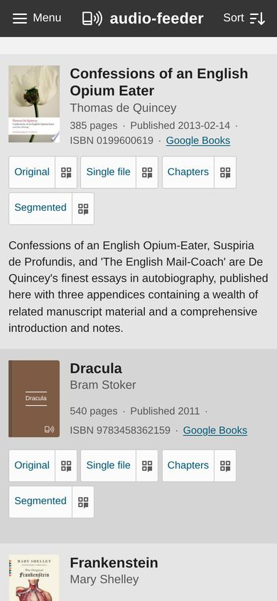

``audio-feeder`` is a Flask-based web-app that hosts your audiobooks (or other audio content) as RSS feeds compatible with podcatchers.

The full documentation is at https://audio-feeder.readthedocs.io/.

Features
========

.. image:: docs/images/screenshots/list_entry_p0.jpg
    :width: 800px
    :alt: The main list interface

``audio-feeder`` finds the books in a directory on disk, looks up their metadata from Google Books, and lists them in a web page that also works well on mobile, from which you can subscribe to each book's feed.

- Books can be browsed by the folders they're organized in, and filtered by tag, language, author and the date they were added.
- In addition to a feed of the files as they are on disk, each book can have "rendered" feeds generated with ``ffmpeg``: the whole book merged into a single file, one file per chapter, or segments of about an hour each.
- Each feed has a QR code, so that you can browse the list from a computer and scan the feed you want from your phone.

Installation and use
====================

``audio-feeder`` requires ``ffmpeg`` with at least the ``aac`` codec (the tests also require the ``libmp3lame`` codec). Install it with ``pip install audio-feeder`` or ``uv tool install audio-feeder``, and create a server directory with:

.. code-block:: console

    $ audio-feeder install --config-dir ~/audiobook_server

Then put your books in ``~/audiobook_server/static/media``, and from ``~/audiobook_server``, load them into the database and start the server:

.. code-block:: console

    $ audio-feeder update
    $ audio-feeder run

See `the documentation <https://audio-feeder.readthedocs.io/>`_ for how to lay out your books, the configuration settings and how to deploy it. Probably the easiest way to deploy it is via Docker, using the docker-compose configuration in the `audio_feeder_docker repository <https://github.com/pganssle/audio_feeder_docker>`_.

To try it out on some example books, run ``tox -e start_server`` from a checkout of this repository.

Note
=====

While the state of this is getting much closer to something production-ready, I am emphatically *not* a front-end developer, and I don't have extremely high confidence in the security of this project. Use at your own risk (and if you do come up with some security and/or usability improvements, please do send a PR).

This is only tested on Linux, but it may also work on other platforms.

License
=======
All images and documentation contained herein are licensed under `CC-0 <https://creativecommons.org/publicdomain/zero/1.0/>`_.

The code is released under the `Apache 2.0 <https://www.apache.org/licenses/LICENSE-2.0>`_ license.

Contributing
============
Pull requests and issues are more than welcome. Please be aware that your contributions will be released under the licenses stated above. If you are not comfortable with that, please do not make a pull request.

User-facing changes should come with a changelog entry, which is managed with `scriv <https://scriv.readthedocs.io/>`_. Running ``tox -e changelog`` creates a new fragment in ``changelog.d/``; uncomment the section for the kind of change (Features, Bugfixes or Misc), describe the change in a sentence or two (in reStructuredText) and commit it with the rest of your changes. When a release is made, the fragments are collected into ``CHANGELOG.rst`` with ``tox -e changelog -- collect --version <version>``, under a heading with the version and the release date (e.g. ``Version 0.6.2 (2022-12-03)``). CI checks that every pull request adds a fragment; for changes that don't need one (e.g. refactoring or CI changes), add the ``skip-changelog`` label to the pull request.
