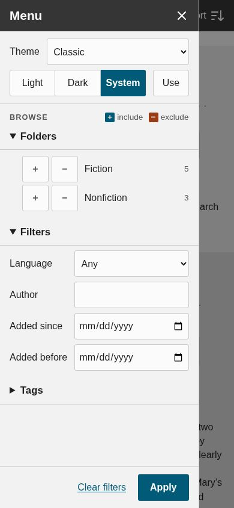
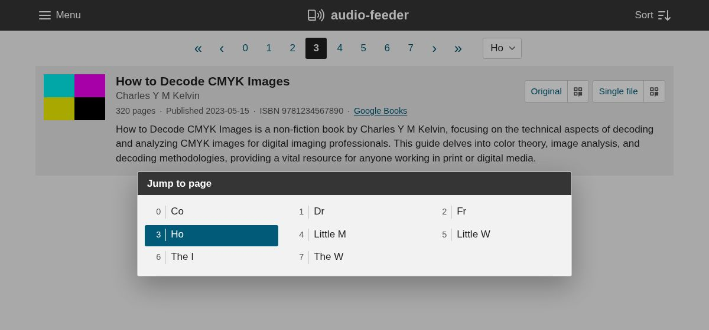

Browsing the library
====================

The book list at ``/books`` shows every book in the library, a page at a time,
with its cover, description and links to its feeds. Two buttons at the top of
the page control which books are shown and in what order: "Menu" at the top
left opens the menu, for filtering the list, and "Sort" at the top right opens
the sort menu.

Every choice you make in either of them ends up in the page's URL, so you can
bookmark a filtered view of the library or send a link to one, and the page
navigation keeps the filters and the sort order as you move between pages.

The menu
--------

The top of the menu chooses the theme and, for themes with a light and a dark
version, whether to use the light one, the dark one, or whichever matches the
system; click "Use" to switch. These are described in :doc:`themes`.

Below that, under "Browse", are three sections for filtering the list: the
folder tree, a few filters on the books' metadata, and the tags. Changes take
effect when you click "Apply", and "Clear filters" goes back to showing every
book. The menu button shows the number of filters that are active, counting
each included or excluded folder or tag separately.

When no books match the filters, the page says so, with a link to clear them.

.. _folders:

Folders
~~~~~~~

The folder tree mirrors the directories that your books are organized in
inside the media directory, with the number of books in each folder. Each
folder has a ``+`` button to include it and a ``−`` button to exclude it, and
you can include and exclude any number of folders at once. When you include
some folders, only the books somewhere below at least one of them are shown;
books below an excluded folder are never shown. Including a folder and
excluding one of its subfolders shows everything in the folder except that
subfolder.

The counts in the tree reflect the other filters (but not the folder filters
themselves), so you can see where the books that match, say, a tag are.

When a single folder is included, breadcrumbs above the list link to each of
the folders above it.

To keep the tree compact, a folder that contains nothing but a single
subfolder is skipped, and the folders inside that subfolder are shown with the
combined path; for example, if ``Fiction`` contains only ``Classics``, which
contains ``Gothic`` and ``Romance``, then ``Fiction`` has the two children
``Classics/Gothic`` and ``Classics/Romance``. Similarly, if every book is below
a single folder, such as ``audiobooks/``, that folder isn't shown in the tree,
the breadcrumbs or the page title, since including it would be the same as
showing everything.

Filters
~~~~~~~

The filters section narrows the list down by the books' metadata:

Language
    Only show books in the chosen language. The menu lists the languages in
    the library, most common first.

Author
    Only show books with an author whose name contains this text, ignoring
    case and accents, so ``bronte`` matches "Charlotte Brontë".

Added since / Added before
    Only show books added to the library on or after (for "Added since") or
    before (for "Added before") the chosen date, using the UTC date the book
    was added.

Tags
~~~~

A book's tags include the categories that Google Books gives for it. As with
folders, each tag has a ``+`` button to include it and a ``−`` button to
exclude it. Books with any excluded tag are never shown. When you include tags,
the "Show books with any / all of the included tags" choice above the list
decides whether a book needs at least one of them (the default) or every one of
them.

The tags that are currently included or excluded are listed first, followed
by the rest from most to least common; only the first fifteen are shown, and
the rest are under "All tags". Tags are matched without regard to case.

The sort menu
-------------

The sort menu chooses the order of the books and how many to show on each
page:

Sort order
    "Date Added" (the default), "Author", "Title" or "Last Modified". Books
    that are tied are ordered by the other fields; for example, sorting by
    author orders each author's books by series, then title.

Direction
    Ascending or descending. The default is descending (newest first) for
    the two dates, and ascending for author and title.

Items per page
    25 by default.

Moving between pages
--------------------

The links above and below the list go to the first, previous, next and last
pages, and to the pages near the current one. To keep them short, they only
list the first and last three pages and the pages either side of the current
one, with "…" in place of the rest, e.g. ``0 1 2 … 11 12 13 … 77 78 79``. On a
phone, only the arrows and the current page are shown.

To get to any other page, use the button next to the page links, which shows
the range of the current page and opens a list of every page with the range of
the sort order that it covers. For example, when sorting by
title, a page might cover "Little M → Little W", meaning its first book's title
starts with "Little M" and its last book's with "Little W"; each end is just
long enough to tell it apart from the pages around it. When sorting by date,
the range leaves out what both ends have in common, e.g. "3 → 17 Mar 2023" or
"Dec 2022 → Feb 2023".

Pages are numbered from 0.
