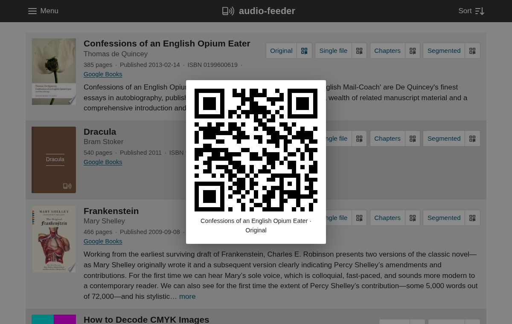

Feeds
=====

Every book has an RSS feed at ``/rss/<id>.xml``, which contains the book's
audio files as they are on disk; it's the "Original" button next to each book in
the book list.
You can subscribe to it in any podcast app that lets you add a feed by URL.

Rendered feeds
--------------

Depending on what metadata is available, ``audio-feeder`` can also generate
"rendered" feeds for each book, at ``/rss/derived/<id>-<mode>.xml``, which
contain files made from the originals with ``ffmpeg``. They are the buttons
after "Original" in the book list:

Single file
    This feed consists of a single file. If the original directory contains
    multiple files, they are merged together, and if the original files don't
    have chapter information, each of them is treated as a separate chapter.
    This feed is always available.

Chapters
    This feed has one file per chapter. The book list only links to it if
    the original files have explicit chapter metadata, e.g. in an ``m4b``
    file or from Overdrive MediaMarkers, but the feed works for any book. A
    file without chapter information, or with chapter information that can't
    be used (a chapter that starts after the end of the file), is treated as
    a single chapter, so for a book without any usable chapter information,
    this feed redirects to the original feed (see below).
    When some of a book's chapter information can't be used, the book list
    shows a small warning sign on its "Chapters" button.

Segmented
    This feed splits up and recombines the files so that each one is about
    an hour long. Files are only split along chapter boundaries, though they
    can be combined from files without chapter information, and the
    algorithm is slightly biased towards longer files, so it will prefer to
    make one 90 minute file rather than two 45 minute files. This feed is
    available if the book has more than one file, or if it has chapter
    information (or both).

The files for a rendered feed are generated in the background the first time
the feed is requested, and they are kept in the media cache directory
(``media_cache`` in the static directory, by default) for later requests. The
feed itself is returned right away, though for a large book the files may take
a while to be ready to download. When every rendered file would just be a copy of
one of the original files, the rendered feed redirects to the book's original
feed instead.

QR codes
--------

Each feed has an associated QR code, so that you can browse the list on a
computer and scan the individual feeds from your phone. Click the QR code icon
on a feed's button to show the code; clicking anywhere outside of it or pressing
Escape closes it again:

The QR codes encode the feeds' URLs, which are built from the ``base_protocol``,
``base_host`` and ``base_port`` settings (see :doc:`configuration`), so they
are only useful if those make up an address that your phone can reach. The
images are cached in the QR cache directory, with a separate subdirectory for
each base URL, so changing these settings generates new codes rather than
reusing stale ones.
