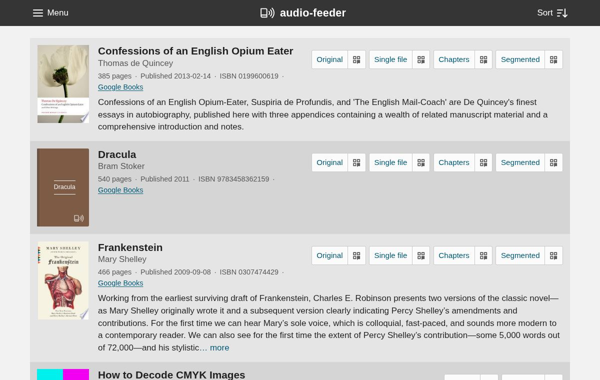

audio-feeder
============

``audio-feeder`` is a web app that serves your audiobooks (or other audio
content) as RSS feeds that you can subscribe to in a podcast app. It finds the
books in a directory on disk, looks up their metadata (descriptions, covers,
tags and so on) from Google Books, and shows them in a web page from which you
can subscribe to each book's feed.

Each book has its own feed containing the files as they are on disk, and
``audio-feeder`` can also generate "rendered" feeds from them with ``ffmpeg``:
one with all the files merged into a single file, one with a file per chapter,
and one with the book split into segments of about an hour. Each feed also has
a QR code, so that you can browse the list on a computer and scan the feed you
want with your phone. See :doc:`feeds` for the details.

.. note::

    While this is getting much closer to something production-ready, I am
    emphatically *not* a front-end developer, and I don't have extremely high
    confidence in the security of this project. Use it at your own risk (and
    if you do come up with some security or usability improvements, please
    send a PR).

    It is only tested on Linux, but it may also work on other platforms.

.. toctree::
   :maxdepth: 2
   :caption: Contents

   installation
   usage
   browsing
   themes
   feeds
   configuration
   cli
   development
   changelog

License
-------

All images and documentation are released under `CC-0
<https://creativecommons.org/publicdomain/zero/1.0/>`_, and the code is released
under the `Apache 2.0 <https://www.apache.org/licenses/LICENSE-2.0>`_ license.
The source is on `GitHub <https://github.com/pganssle/audio-feeder>`_, where pull
requests and issues are welcome.
